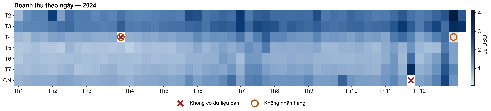
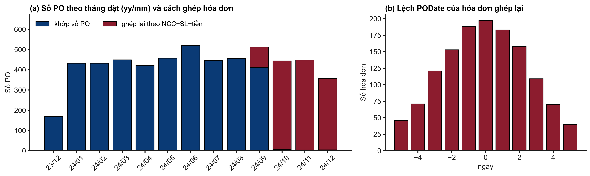
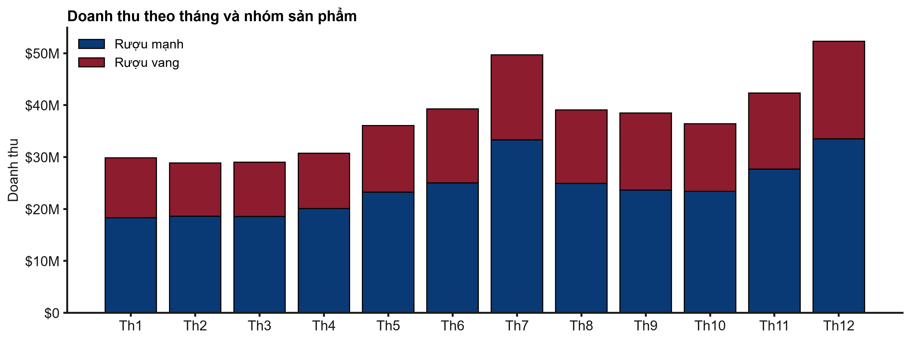
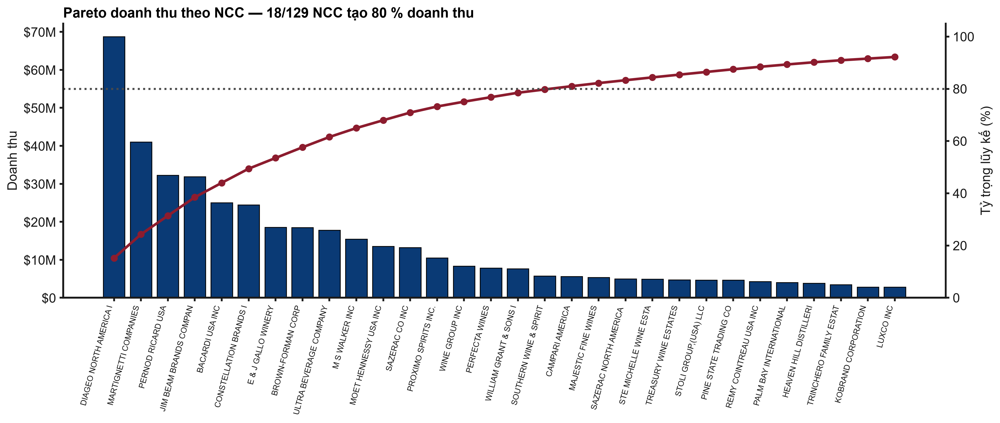
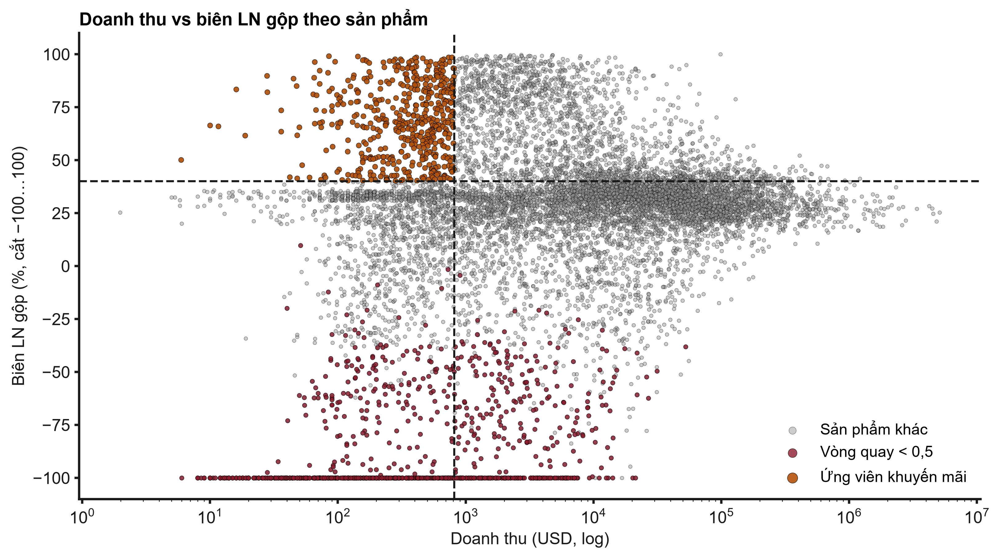

# Báo cáo EDA: Vendor Performance Analysis (2024)

> **Dữ liệu:** 6 file CSV nguồn trong `data/raw/` (chuỗi bán lẻ rượu: 80 cửa hàng, 129 nhà cung cấp, 12 261 sản phẩm, năm 2024)
> **Không dùng:** `inventory.db`. `vendor_sales_summary.csv` chỉ dùng để **kiểm chứng** kết quả tự tính.
> **Chi tiết và biểu đồ:** `notebook/01`–`04`. Hình ở `reports/figure/`, bảng ở `reports/table/`.
> Mọi con số dưới đây được tính lại từ `data/processed/analytics.db` (dựng bởi `sql/`).

---

## 1. Tóm tắt

| # | Phát hiện | Con số chính |
| --- | --- | --- |
| 1 | Doanh thu 2024 ≈ **452,1 triệu USD**. Tiền mua ≈ 321,9 triệu. Lợi nhuận gộp ≈ 130,2 triệu (**biên 28,8 %**). | Phí vận chuyển 1,64 triệu (≈ 0,5 % tiền mua) |
| 2 | **Lỗi dữ liệu nghiêm trọng nhất:** số PO trên `vendor_invoice` bị xáo trộn từ PO 12311 (đặt từ 25/09/2024). Đã ghép lại 100 % theo (NCC, số lượng, tiền). | 1 336/5 543 hóa đơn |
| 3 | Kết luận "lợi thế quy mô về vận chuyển" là **giả**, sinh ra do nối hóa đơn sai. Sau khi sửa, phí vận chuyển tỷ lệ thuận với tiền mua. | Hệ số log–log 1,00; ρ = 0,09 |
| 4 | Thiếu dữ liệu bán ngày **27/03** và **24/11**. Năm nhuận có 366 ngày, `sales` chỉ có 364. | 2 ngày |
| 5 | Tồn kho **cân đối tuyệt đối**: đầu kỳ + mua − bán = cuối kỳ. | 276 389/276 389 mã tồn kho |
| 6 | Doanh thu tập trung vào ít NCC. | 18/129 NCC tạo 80 % doanh thu; Gini 0,84 |
| 7 | Mùa vụ mạnh, đỉnh vào tháng 7 và tháng 12. | 29 → 50 → 52 triệu USD/tháng |
| 8 | Có thể hành động ngay với hai nhóm sản phẩm. | 1 280 sản phẩm chậm luân chuyển (~3,3 triệu USD giá vốn); 524 ứng viên khuyến mãi |

---

## 2. Dữ liệu và phương pháp

| Bước | Nội dung | Nơi thực hiện |
| --- | --- | --- |
| Nạp | 6 CSV nguồn (+ 1 CSV tham chiếu) được nạp nguyên trạng vào `data/interim/staging.db` | `sql/staging/00_schema.sql` |
| Tổng hợp | Quét bảng lớn **một lần** để tạo các bảng `dim_*`, `mart_*`, `sample_*` (~89 MB) | `sql/build/01`–`05` |
| Kiểm tra | Chất lượng (`dq_checks`), ngày tháng (`dq_dates`, `dq_calendar`), nhất quán giữa file (`dq_consistency`), cân đối tồn kho (`mart_stock_flow`) | `sql/build/06`, `08` |
| Kiểm chứng | So kết quả tự tính với `vendor_sales_summary.csv`: khớp 10 692/10 692 cặp, phí vận chuyển khớp 126/126 NCC | `sql/build/07_validation.sql` |
| Phân tích | 4 notebook gọi 32 truy vấn trong `sql/queries/` | `notebook/01`–`04` |

**Định nghĩa KPI:**

- `lead_days` = ngày nhận **cuối** − ngày đặt (nhận đủ hàng).
- `pay_days` = ngày trả − ngày hóa đơn.
- Biên gộp = (doanh thu − tiền mua) / doanh thu.
- "Vòng quay" = số lượng bán / số lượng mua (tỷ lệ bán/mua), không phải vòng quay kế toán.
- Giá trị tồn kho tính theo **giá bán lẻ** của từng ảnh chụp tồn kho.

---

## 3. Chất lượng dữ liệu

### 3.1. Ngày tháng (`notebook/01` §5)

| Kiểm tra | Kết quả |
| --- | --- |
| Định dạng `YYYY-MM-DD` hợp lệ và ngày có thật | **Đạt**: 22,8 triệu giá trị, 0 lỗi |
| Ngày giao dịch (bán, nhận hàng) nằm trong 2024 | **Đạt** |
| Thứ tự đặt → nhận → hóa đơn → thanh toán | **Đạt**: 0 vi phạm trong `purchases` và `vendor_invoice` |
| Chứng từ vắt kỳ | Hợp lệ: PODate từ 20/12/2023; InvoiceDate/PayDate đến 19/02/2025 |
| Ngày thiếu dữ liệu | **Cảnh báo**: không có dòng bán nào ngày 27/03 (T4) và 24/11 (CN). Ngày 27/03 cũng không có nhận hàng, nên nhiều khả năng mất dữ liệu ngày này. Ngày 25/12 không nhận hàng là hợp lý. |



### 3.2. Nhất quán giữa các file (`notebook/01` §6)

Có 39 kiểm tra chéo: **1 Lỗi, 16 Cảnh báo, 22 Đạt**.

| Nhóm | Kết quả | Ghi chú |
| --- | --- | --- |
| **Hóa đơn ↔ dòng mua** | **Lỗi.** 1 336 hóa đơn mang số PO của PO khác (cùng đợt đặt, PODate lệch ±5 ngày; ngày hóa đơn và ngày trả cũng khác) | Đã sửa bằng bảng `map_invoice_po`. Đây là nguyên nhân của mục "~24 % PO lệch hóa đơn" trong `data_dictionary.md`. |
| Khóa & liên kết | Đạt: không trùng khóa, không có Brand mồ côi, `InventoryId` luôn đúng mẫu `Store_City_Brand`, mỗi Store thuộc đúng 1 City | 20 347 mã tồn kho chỉ có giao dịch (mua rồi bán hết trong năm), không phải lỗi |
| Tồn kho | Đạt: lệch 0 chai; không bán vượt lượng sẵn có; không có tồn âm | Cân đối hoàn hảo, cho thấy dữ liệu là mô phỏng |
| Số học | Đạt: thành tiền = đơn giá × số lượng ở 15,2 triệu dòng; thuế tiêu thụ ≈ 1,05 USD/lít (rượu mạnh), ≈ 0,15 USD/lít (vang) | |
| Thuộc tính sản phẩm | Cảnh báo: `Size` ghi khác giữa danh mục (`1500mL`) và giao dịch (`1.5L`, `Liter`) ở ~1 400 sản phẩm; chỉ 33 sản phẩm khác dung tích thật | Dùng `Volume` khi cần giá trị số |
| | Cảnh báo: `Description` trong tồn kho đầu kỳ khác danh mục ở 2 755 dòng ("Glass Pack" ↔ "VAP") | Luôn nối theo `Brand` |
| Nhà cung cấp | Cảnh báo: 91 trường hợp Brand giao dịch dưới mã NCC khác danh mục; 2 mã NCC có 2 tên | Gộp theo mã NCC |
| Giá | Cảnh báo: giá bán khác giá niêm yết ở 46 % dòng; giá tồn kho khác ở 43–50 % dòng | Giá danh mục chỉ là giá tham chiếu, doanh thu lấy từ `SalesDollars`. Giá mua thì luôn khớp danh mục. |



### 3.3. Vấn đề trong từng file (`notebook/01` §3–4)

- `VendorName` có khoảng trắng thừa ở 85–93 % dòng → cần `TRIM`.
- `Approval` rỗng ở 93,3 % dòng.
- `end_inventory.City` thiếu ở 1 284 dòng, đều thuộc Store 46 → điền lại được từ đầu kỳ.
- `Volume` có giá trị `Unknown` ở 5 dòng.
- Giá bằng 0 ở dưới 0,01 % số dòng.

---

## 4. Phân phối (`notebook/02`)

- **Mọi biến tiền và số lượng đều lệch phải mạnh.**
  - Một dòng bán điển hình: 1 chai, giá khoảng 13 USD, doanh thu khoảng 19 USD.
  - Vì vậy nên dùng thang log và trung vị. Ngoại lai được đếm theo IQR trên log10.
- **Hai nhóm sản phẩm khác nhau rõ:**
  - Rượu vang chiếm ~70 % số sản phẩm nhưng chỉ ~36 % doanh thu.
  - Biên đơn vị của vang cao hơn (~34 % so với ~26 %).
- **Chuỗi cung ứng đều:**
  - Lead time (đặt → nhận đủ) trung bình 9,9 ngày (3–14 ngày); nhận lô đầu sau trung bình 6 ngày.
  - 5 000/5 543 PO được giao làm nhiều đợt.
  - Thời gian thanh toán trung bình 35,5 ngày.
  - Phí vận chuyển ≈ 0,50 % giá trị hóa đơn; 84 PO vượt 1 %.
- **Hiệu quả sản phẩm:**
  - Biên gộp trung vị ~31 %.
  - ~19 % cặp NCC × sản phẩm lỗ gộp; 178 sản phẩm mua về nhưng không bán được.
- **Thời gian:**
  - Doanh thu tăng từ ~29 triệu USD/tháng (quý 1) lên đỉnh tháng 7 (49,7 triệu) và tháng 12 (52,3 triệu).
  - Thứ 2–3 bán cao nhất, thứ 5–6 thấp nhất. Mẫu hình này bất thường so với bán lẻ thực tế, có thể do dữ liệu mô phỏng.
- **Tồn kho:**
  - Giá trị tồn tăng ~17 % (68,1 → 79,7 triệu USD).
  - ~31 nghìn mặt hàng biến mất và ~49 nghìn mặt hàng mới xuất hiện tại các cửa hàng.



---

## 5. Quan hệ giữa các biến (`notebook/03`)

- **Quy mô chi phối:** các chỉ tiêu quy mô (số lượng, tiền mua, doanh thu, số cửa hàng bán) tương quan rất mạnh với nhau (ρ ≈ 0,84–0,95). Biên % và vòng quay gần như **độc lập với quy mô** (|ρ| < 0,2).
- **Đường cầu dốc xuống:** hệ số log–log giữa giá và số lượng bán ≈ −0,9. Đây là tương quan, chưa phải quan hệ nhân quả.
- **Phân khúc giá:** biên giảm từ ~34 % (dưới 10 USD) xuống ~21 % (từ 100 USD trở lên). Rượu vang có biên cao hơn ở mọi phân khúc.
- **Nhà cung cấp:**
  - Doanh thu tập trung: 18/129 NCC tạo 80 %; Diageo một mình ~15 %; top 10 ~65 %; HHI ≈ 584.
  - **Không có lợi thế quy mô về vận chuyển**: mọi NCC đều chịu ~0,5 %.
  - NCC lớn có lead time dài hơn (ρ ≈ +0,85), vì PO lớn được giao cho nhiều cửa hàng theo nhiều đợt.
- **Mua theo sát bán:** tỷ lệ số lượng bán/mua lớn hơn 1 ở các tháng 4, 7 và 12 (rút tồn vào mùa cao điểm), thấp nhất ở tháng 8.
- **Cửa hàng:** doanh thu tương quan mạnh với giá trị tồn kho (ρ ≈ 0,88–0,92). Hình dạng mùa vụ giống nhau giữa các cửa hàng.



---

## 6. Gợi ý hành động (`notebook/04`)

| Nhóm | Số lượng | Hành động | File |
| --- | --- | --- | --- |
| Sản phẩm bán chạy (top 15, dẫn đầu là Jack Daniels No 7 với 5,1 triệu USD) | 15 | Đảm bảo không đứt hàng | `reports/table/04_top_brands.csv` |
| Chậm luân chuyển (vòng quay < 0,5) | 1 280 | Giảm nhập, xả tồn (~3,3 triệu USD giá vốn chưa bán) | `04_slow_moving_brands.csv` |
| Ứng viên khuyến mãi (doanh thu ở 25 % thấp nhất, biên ở 25 % cao nhất) | 524 | Tăng trưng bày hoặc khuyến mãi | `04_promo_candidates.csv` |
| Hóa đơn từ 25/09/2024 | 1 336 | Đối soát lại với NCC trước khi phân tích công nợ | `01_consistency_checks.csv` |



---

## 7. Giả thuyết cho bước tiếp theo

1. **H1:** NCC lớn và NCC nhỏ có biên gộp khác nhau không? Kiểm định Mann–Whitney, kiểm soát nhóm sản phẩm.
2. **H2:** Hàng chậm luân chuyển có tập trung ở phân khúc giá cao không? Kiểm định χ² giữa `PriceBand` và cờ vòng quay < 0,5.
3. **H3:** Mô phỏng tác động lên lợi nhuận khi giảm giá 5–15 % cho 524 ứng viên khuyến mãi, dùng độ co giãn ≈ −0,9.
4. **H4:** Với 1 336 hóa đơn bị xáo trộn, ngày hóa đơn và ngày trả nào là đúng? Câu trả lời quyết định độ tin cậy của `pay_days`.

---

## 8. Hạn chế

- Dữ liệu là **mô phỏng**: tồn kho cân đối tuyệt đối và mẫu hình theo thứ trong tuần khác thực tế. Kết luận kinh doanh chỉ mang tính minh họa.
- Biên và vòng quay được tính trên cả năm, **chưa trừ tồn đầu kỳ**. Sản phẩm mua nhiều vào cuối năm sẽ bị đánh giá thấp.
- Thuế tiêu thụ chưa được trừ khỏi lợi nhuận, vì chưa rõ nó có nằm trong `SalesDollars` hay không.
- Thiếu dữ liệu bán ngày 27/03 và 24/11 làm doanh thu tháng 3 và tháng 11 thấp hơn thực tế.

---

## 9. Tái lập

```bash
pip install -r requirements.txt
python -c "from src.data_loader import build_marts; build_marts()"    # ~10 phút lần đầu
python -m pytest tests -q                                             # 21 test
cd notebook && for f in 0*.ipynb; do python -m nbconvert --to notebook --execute --inplace "$f"; done
```
